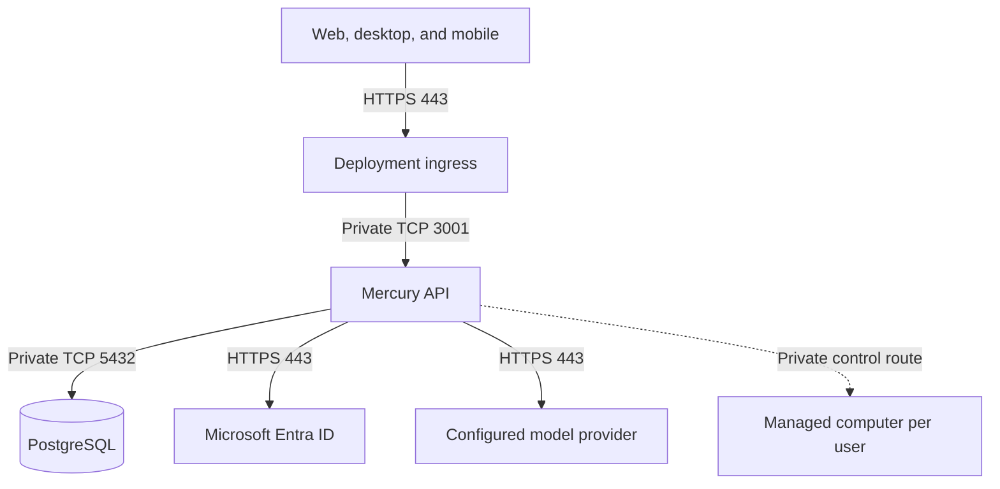

# Mercury overview

Mercury is an AI workspace for conversations, document work, and projects.
People ask Bots to research a question, prepare a deliverable, or follow up on
a task. Teams track shared projects and assignments in Work.

- [Using Mercury](using-mercury.md) explains conversations, files, Work, and how people supervise a Bot.
- [Identity, network access, and Vault](access-and-credentials.md) covers sign-in, permissions, and saved logins.
- [Backup and recovery](backup-and-recovery.md) explains what to back up and how Mercury is restored.
- [Optional integrations](integrations.md) covers Microsoft 365, DataFlow, and other specialized plugins.

## Deployment

Web, desktop, and mobile clients connect through one HTTPS entry point. The API
manages sessions, conversations, and tool access. PostgreSQL stores application
records.

A single Linux host can run the API, PostgreSQL, and managed agent computers.
When enabled, managed Linux agent computers run browser, shell, and file tools
in isolated Sysbox containers that share the host's Linux kernel. A user's
Bots share that user's computer.

Each managed Linux agent computer keeps its workspace on a dedicated persistent
volume. The nightly backup covers that volume alongside PostgreSQL and the
protected deployment configuration.

## Network and firewall ports

Clients use inbound TCP 443 on the Mercury ingress for the app, sign-in
callbacks, and streaming. IT can limit access to approved office networks or
a VPN. The ingress passes streaming responses and WebSocket upgrades.

| Traffic | Typical TCP port | Allowed path |
| --- | --- | --- |
| App access | 443 | Inbound from approved client networks to the HTTPS ingress. |
| Sign-in and model requests | 443 | Outbound HTTPS from clients and the API to Entra, and from the API to the approved model endpoint. |
| Mercury API | 3001 | From ingress to API over loopback or a private service network. |
| PostgreSQL | 5432 | From the API and authorized maintenance processes over a private connection. |
| Computer supervisor | 4300 in the container, typically 4500 on host loopback | Private API-to-supervisor route when managed computers are enabled. |
| Managed computer control | 4100 | The private gateway forwards authenticated control requests to the assigned computer. A host-local gateway listener, when used, has a separate assigned port. |
| Computer callbacks and egress proxy | 3000 and 8080 in the standard restricted setup | From the computer to its callback gateway and, if enabled, its egress proxy on its isolated network. |
| Credential broker | 4400 on host loopback | Private API-to-broker route when brokered features are enabled. |

TCP 443 is the client-facing listener. Keep the internal ports on loopback or
their approved private networks. Optional connectors and computer destinations
use their own approved hosts and ports.
[Per-user IP assignments](access-and-credentials.md#per-user-network-access)
explains which source IP to use in firewall rules.

## Support and maintenance

Deployment operators manage configuration, updates, troubleshooting, and
recovery. If remote support is needed, use an approved route, such as a VPN,
that works even when Mercury is down. Document how updates are delivered and
which outbound destinations the host needs for setup, maintenance, and backups.

## Azure model access

For Azure inference, the Mercury host connects to the approved model endpoint
over HTTPS on TCP 443 using a configured credential. The organization can
manage its own Azure resources or use Azure Lighthouse to delegate model and
cost management roles for the designated resource group.
