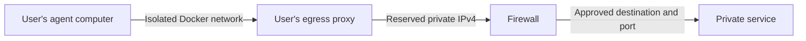
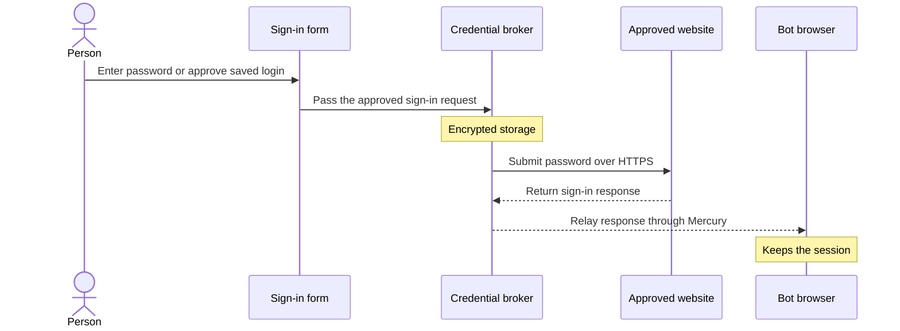

# Identity, network access, and credentials

Mercury uses Microsoft Entra ID for workplace sign-in. IT can apply application
assignment, MFA, device requirements, and sign-in location policies. A Mercury
administrator separately approves workspace access and assigns a role.

## Per-user and Bot access

Each Bot belongs to one person and operates on that person's behalf. People
can collaborate in the same Work project using their own Bots.

Administrators can assign profiles that limit available models, connected
apps, browser use, shell and file access, and background work.
A Bot can inherit its owner's profile or use a narrower one. Mercury checks
the signed-in user, the applicable profiles, and tool grants before it runs an
action. The connected service applies its own account and resource permissions.

Workspace administrators can revoke Mercury access and end local sessions.
Mercury audits sign-ins, administrative changes, and governed tool decisions.

## Per-user network access

Entra can check the public IP ranges of approved offices or VPNs at sign-in.
Mercury's private ingress or firewall rules also govern where clients can
connect after sign-in.

For restricted Linux deployments, each user has an isolated Docker network
for the computer shared by their Bots. The computer gets an internal address
on that network. If it needs access to approved private systems, IT
reserves one private IPv4 address for that user on the selected LAN or VLAN.
Mercury assigns that address to the user's egress proxy. The proxy is the
source of the connection that IT can allowlist in the firewall.

The proxy allows only the configured destinations and ports. The computer
has no direct outbound route in this setup. The Mercury API reaches the
approved model endpoint from the host's network, so agent computers need
no model endpoint access. During setup, verify the source IP seen by the
firewall and test an allowed and a denied destination.

## Credential handling

Users enter their workplace password at Microsoft. Connected accounts use
their own consent flows or dedicated credential forms. Mercury encrypts stored
integration secrets with AES-GCM. Deployment operators supply service credentials
and encryption keys through protected configuration and retain durable keys for
recovery.

## Vault

In **Settings → Vault**, people can save, update, or remove website logins.
Mercury stores saved passwords encrypted in a separate credential broker. A
person can choose to approve each use or allow Mercury to reuse the login
for that specific website and account.

When a Bot needs to sign in, the person can enter a password in a private
form or use a saved login. The broker submits the password over HTTPS to the
approved website. The browser keeps the resulting session, and the password
stays out of the conversation and the model's inputs. People can also use a
website password once without saving it.

[Mercury overview](README.md) · [Optional integrations](integrations.md)
